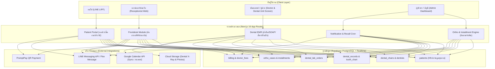
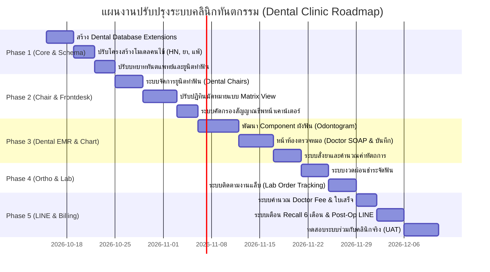

# แผนแม่บทการพัฒนายกระดับระบบสู่ "ระบบบริหารจัดการคลินิกทันตกรรม" (Dental Clinic Management System)
**รหัสโครงการ:** DENTAL-TRANSFORM-2026  
**อ้างอิงฐานระบบเดิม:** SPA Management System (`SPA-sb`)  
**เป้าหมาย:** ปรับปรุงและต่อยอดระบบจากระบบสปา เป็นระบบคลินิกทันตกรรมครบวงจร (Dental EMR, Dental Chair & Doctor Scheduling, Odontogram, Orthodontic Tracking, Lab Orders, Billing & LINE Automation)

---

## สารบัญ (Table of Contents)
1. [บทสรุปผู้บริหาร (Executive Summary)](#1-บทสรุปผู้บริหาร-executive-summary)
2. [วิเคราะห์เปรียบเทียบระบบเดิม vs ระบบคลินิกทันตกรรม (Gap Analysis)](#2-วิเคราะห์เปรียบเทียบระบบเดิม-vs-ระบบคลินิกทันตกรรม-gap-analysis)
3. [สถาปัตยกรรมระบบโดยรวม (System Architecture)](#3-สถาปัตยกรรมระบบโดยรวม-system-architecture)
4. [โครงสร้างฐานข้อมูลและการออกแบบ Schema (Database Design & SQL Migration)](#4-โครงสร้างฐานข้อมูลและการออกแบบ-schema-database-design--sql-migration)
5. [ฟังก์ชันและโมดูลเฉพาะทางสำหรับคลินิกทันตกรรม (Dental Specific Modules)](#5-ฟังก์ชันและโมดูลเฉพาะทางสำหรับคลินิกทันตกรรม-dental-specific-modules)
   - 5.1 [เวชระเบียนทันตกรรมและข้อมูลคนไข้ (Dental Patient EMR & HN)](#51-เวชระเบียนทันตกรรมและข้อมูลคนไข้-dental-patient-emr--hn)
   - 5.2 [ผังฟันดิจิทัล (Interactive Odontogram / Tooth Charting)](#52-ผังฟันดิจิทัล-interactive-odontogram--tooth-charting)
   - 5.3 [ระบบจองคิวควบคู่: แพทย์ + ยูนิตทำฟัน (Dual-Resource Scheduling)](#53-ระบบจองคิวควบคู่-แพทย์--ยูนิตทำฟัน-dual-resource-scheduling)
   - 5.4 [ระบบงานจัดฟันและการผ่อนชำระ (Orthodontic Tracking & Installments)](#54-ระบบงานจัดฟันและการผ่อนชำระ-orthodontic-tracking--installments)
   - 5.5 [ระบบติดตามงานแล็บทันตกรรม (Dental Lab Orders Tracking)](#55-ระบบติดตามงานแล็บทันตกรรม-dental-lab-orders-tracking)
   - 5.6 [ระบบคิดเงินและการเงินทันตแพทย์ (Billing & Doctor Fee - DF)](#56-ระบบคิดเงินและการเงินทันตแพทย์-billing--doctor-fee---df)
   - 5.7 [ระบบ LINE LIFF & ระบบแจ้งเตือนอัตโนมัติ (Automated Recall & Post-Op)](#57-ระบบ-line-liff--ระบบแจ้งเตือนอัตโนมัติ-automated-recall--post-op)
6. [แผนการดำเนินงานทีละเฟส (Phased Implementation Roadmap)](#6-แผนการดำเนินงานทีละเฟส-phased-implementation-roadmap)
7. [การรักษาความมั่นคงปลอดภัยและความเป็นส่วนตัว (PDPA & Medical Compliance)](#7-การรักษาความมั่นคงปลอดภัยและความเป็นส่วนตัว-pdpa--medical-compliance)

---

## 1. บทสรุปผู้บริหาร (Executive Summary)

ระบบปัจจุบันเป็นเว็บแอปพลิเคชัน Next.js (App Router) + Supabase + LINE LIFF ออกแบบสำหรับงานบริการนวด/สปา ซึ่งมีโครงสร้างพื้นฐานที่ดีมากในส่วนของ:
- ระบบนัดหมาย (Appointments) แบบเรียลไทม์
- ระบบการเชื่อมต่อ LINE Account และแจ้งเตือนผ่าน Flex Message
- ระบบชำระเงินมัดจำ/เต็มจำนวนผ่าน QR PromptPay
- ฐานข้อมูลสถิติและคะแนนสะสม

อย่างไรก็ตาม **คลินิกทันตกรรม** เป็นธุรกิจทางการแพทย์เฉพาะทางที่มีเงื่อนไขเข้มงวดกว่าสปาทั่วไป ทั้งในแง่ของกฎหมายวิชาชีพเวชกรรม ความปลอดภัยของคนไข้ (เช่น โรคหัวใจ ทานยาละลายลิ่มเลือด การแพ้ยาชา) และการรักษาที่ซับซ้อน (จัดฟัน ผ่าฟันคุด รักษารากฟัน ส่งทำแล็บ)

เอกสารฉบับนี้กำหนดกรอบแนวทาง (Framework) และแผนการปรับแก้โค้ดเพื่อเปลี่ยนผ่านระบบเดิมสู่ระบบทันตกรรมอย่างเป็นระบบ โดยคงความเสถียรของระบบเดิมไว้และเพิ่มขีดความสามารถทางการแพทย์เข้าไปอย่างครบถ้วน

---

## 2. วิเคราะห์เปรียบเทียบระบบเดิม vs ระบบคลินิกทันตกรรม (Gap Analysis)

| มิติการทำงาน | สภาพเดิม (SPA System) | เป้าหมายใหม่ (Dental Clinic System) | สิ่งที่ต้องปรับเปลี่ยน |
| :--- | :--- | :--- | :--- |
| **ทรัพยากรการนัดหมาย** | จองเฉพาะ "ช่างบริการ" (Technician) | จองพร้อมกัน 2 ทรัพยากร: **ทันตแพทย์ (Dentist)** + **ยูนิตทำฟัน (Dental Chair)** | เพิ่มตาราง `dental_chairs` และตรรกะตรวจเช็คความพร้อมของทั้งเก้าอี้และแพทย์ |
| **ข้อมูลลูกค้า** | บันทึกชื่อ, เบอร์โทร, แต้มสะสม | เวชระเบียนคนไข้ (HN), ประวัติแพ้ยา, โรคประจำตัว, ยาประจำตัว, สตรีมีครรภ์ | เพิ่มฟิลด์การแพทย์สำคัญ และระบบ Warning Alert สีแดงเตือนหมอก่อนเริ่มหัตถการ |
| **บริการ** | คิดราคาเป็นชั่วโมง / ออปชัน | แบ่งเป็น **หัตถการเดี่ยว** (อุดฟัน, ขูดหินปูน), **หัตถการต่อเนื่อง** (จัดฟัน, รักษาราก) และ **งานแล็บ** (ฟันปลอม, ครอบฟัน) | เพิ่มรหัสหัตถการ, ระบบคอร์ส/งวดชำระ, และการผูกซี่ฟันกับค่ารักษา |
| **การตรวจรักษา** | ไม่มีบันทึกทางการแพทย์ | **ผังฟัน 32 ซี่ (FDI System)**, บันทึกการรักษา Progress Note (SOAP), รหัสโรค | พัฒนา Component ผังฟัน (Tooth Charting) และหน้าห้องตรวจสำหรับหมอ |
| **การเงิน** | ชำระเงินก้อนเดียว | ชำระแยกค่างวดจัดฟัน, ค่าแล็บ, หัตถการ, ค่ายา พร้อมคำนวณส่วนแบ่งแพทย์ (Doctor Fee: DF %) | แยกประเภทรายรับในใบเสร็จ และระบบรายงานสรุปยอด DF รายวัน/รายเดือน |
| **หลังการรักษา** | รีวิวให้ดาว, แลกแต้ม | คำแนะนำการดูแลแผล (Post-Op Care) เช่น ห้ามบ้วนน้ำลาย, และระบบ Recall ตรวจฟันทุก 6 เดือน | ส่ง Flex Message อัตโนมัติหลังตรวจเสร็จตามหัตถการที่ทำ |

---

## 3. สถาปัตยกรรมระบบโดยรวม (System Architecture)



---

## 4. โครงสร้างฐานข้อมูลและการออกแบบ Schema (Database Design & SQL Migration)

สคริปต์ SQL ต่อไปนี้สร้างขึ้นเพื่อต่อยอดฐานข้อมูลเดิมใน Supabase:

```sql
-- ==============================================================================
-- DENTAL CLINIC SCHEMA EXTENSIONS
-- ==============================================================================

-- 1. ยูนิตทำฟัน (Dental Chairs)
CREATE TABLE IF NOT EXISTS public.dental_chairs (
    id TEXT PRIMARY KEY DEFAULT gen_random_uuid()::TEXT,
    name TEXT NOT NULL,                     -- เช่น 'Unit 1 (ริมหน้าต่าง)', 'Unit 2', 'ห้องผ่าตัดเล็ก'
    room_number TEXT,
    status TEXT DEFAULT 'available',       -- 'available', 'occupied', 'maintenance'
    color_code TEXT DEFAULT '#3B82F6',     -- สีประจำเตียงสำหรับแสดงบนปฏิทิน
    created_at TIMESTAMPTZ DEFAULT NOW(),
    updated_at TIMESTAMPTZ DEFAULT NOW()
);

-- 2. ขยายตารางคนไข้ (Dental Patient Fields)
ALTER TABLE public.customers ADD COLUMN IF NOT EXISTS hn TEXT UNIQUE;
ALTER TABLE public.customers ADD COLUMN IF NOT EXISTS id_card_number TEXT; -- เลขบัตรประชาชน
ALTER TABLE public.customers ADD COLUMN IF NOT EXISTS blood_group TEXT;     -- A, B, AB, O
ALTER TABLE public.customers ADD COLUMN IF NOT EXISTS drug_allergies TEXT[] DEFAULT '{}';
ALTER TABLE public.customers ADD COLUMN IF NOT EXISTS medical_conditions TEXT[] DEFAULT '{}';
ALTER TABLE public.customers ADD COLUMN IF NOT EXISTS taking_blood_thinners BOOLEAN DEFAULT FALSE; -- ทานยาละลายลิ่มเลือด (สำคัญมาก)
ALTER TABLE public.customers ADD COLUMN IF NOT EXISTS is_pregnant BOOLEAN DEFAULT FALSE;            -- ตั้งครรภ์ (ห้าม X-ray สุ่มสี่สุ่มห้า)
ALTER TABLE public.customers ADD COLUMN IF NOT EXISTS emergency_contact JSONB DEFAULT '{}'::JSONB; -- { name, relation, phone }

-- สร้าง Running Sequence สำหรับ HN อัตโนมัติ (เช่น DN-670001)
CREATE SEQUENCE IF NOT EXISTS patient_hn_seq START 1;

CREATE OR REPLACE FUNCTION generate_patient_hn()
RETURNS TRIGGER AS $$
BEGIN
    IF NEW.hn IS NULL OR NEW.hn = '' THEN
        NEW.hn := 'DN-' || TO_CHAR(NOW(), 'YY') || LPAD(NEXTVAL('patient_hn_seq')::TEXT, 4, '0');
    END IF;
    RETURN NEW;
END;
$$ LANGUAGE plpgsql;

DROP TRIGGER IF EXISTS trg_generate_patient_hn ON public.customers;
CREATE TRIGGER trg_generate_patient_hn
BEFORE INSERT ON public.customers
FOR EACH ROW
EXECUTE FUNCTION generate_patient_hn();

-- 3. ขยายข้อมูลทันตแพทย์ (Dentist Credentials)
ALTER TABLE public.technicians ADD COLUMN IF NOT EXISTS license_number TEXT; -- เลขที่ใบประกอบวิชาชีพทันตกรรม (ท.xxxx)
ALTER TABLE public.technicians ADD COLUMN IF NOT EXISTS specialty TEXT DEFAULT 'General'; -- General, Ortho, Surgery, Endo, Pedo
ALTER TABLE public.technicians ADD COLUMN IF NOT EXISTS df_percentage NUMERIC DEFAULT 50.00; -- ค่า DF เริ่มต้น (%)
ALTER TABLE public.technicians ADD COLUMN IF NOT EXISTS default_chair_id TEXT REFERENCES public.dental_chairs(id);

-- 4. ขยายการนัดหมาย (Dual-Resource Appointment)
ALTER TABLE public.appointments ADD COLUMN IF NOT EXISTS chair_id TEXT REFERENCES public.dental_chairs(id);
ALTER TABLE public.appointments ADD COLUMN IF NOT EXISTS chief_complaint TEXT; -- อาการสำคัญที่มาพบ เช่น ปวดฟันล่างขวา, นัดเปลี่ยนยาง
ALTER TABLE public.appointments ADD COLUMN IF NOT EXISTS vital_signs JSONB DEFAULT '{}'::JSONB; -- { bp_systolic, bp_diastolic, pulse, temp }

-- 5. ผังฟันและบันทึกเวชระเบียน (Dental EMR & Tooth Records)
CREATE TABLE IF NOT EXISTS public.dental_records (
    id TEXT PRIMARY KEY DEFAULT gen_random_uuid()::TEXT,
    appointment_id TEXT REFERENCES public.appointments(id),
    patient_id TEXT NOT NULL REFERENCES public.customers(id),
    dentist_id TEXT NOT NULL REFERENCES public.technicians(id),
    chair_id TEXT REFERENCES public.dental_chairs(id),
    tooth_number TEXT NOT NULL,           -- รหัสฟัน FDI เช่น '11', '16', '38', 'all'
    surface TEXT,                          -- พื้นผิวฟัน 'MODBL', 'O', 'M', 'D', 'B', 'L'
    condition TEXT,                        -- สถานะฟัน เช่น 'caries', 'filled', 'missing', 'impacted', 'crown', 'rct'
    diagnosis TEXT,                        -- เช่น 'Dental Caries', 'Irreversible Pulpitis'
    treatment_done TEXT NOT NULL,          -- เช่น 'Composite filling 2 surfaces', 'Extraction'
    doctor_notes TEXT,                     -- บันทึกอาการเพิ่มเติม
    anesthesia_used TEXT,                  -- ยาชาที่ใช้ เช่น '2% Mepivacaine 1.8ml (1 carpule)'
    cost NUMERIC DEFAULT 0,                -- ค่าหัตถการ
    df_amount NUMERIC DEFAULT 0,           -- ค่า DF หมอ
    xray_urls TEXT[] DEFAULT '{}',         -- ลิงก์รูปภาพ X-Ray
    created_at TIMESTAMPTZ DEFAULT NOW(),
    updated_at TIMESTAMPTZ DEFAULT NOW()
);

-- 6. ระบบงานจัดฟันและแผนการผ่อนชำระ (Orthodontic Cases & Installments)
CREATE TABLE IF NOT EXISTS public.ortho_cases (
    id TEXT PRIMARY KEY DEFAULT gen_random_uuid()::TEXT,
    patient_id TEXT NOT NULL REFERENCES public.customers(id),
    dentist_id TEXT NOT NULL REFERENCES public.technicians(id),
    plan_name TEXT NOT NULL,               -- เช่น 'จัดฟันโลหะ (Metal Brackets)'
    total_amount NUMERIC NOT NULL,         -- ยอดรวมทั้งหมด เช่น 45,000 บาท
    paid_amount NUMERIC DEFAULT 0,         -- ยอดที่ชำระไปแล้ว
    total_months INTEGER DEFAULT 24,       -- ระยะเวลาประมาณการ (เดือน)
    current_month INTEGER DEFAULT 0,       -- งวดปัจจุบัน
    status TEXT DEFAULT 'in_progress',     -- 'in_progress', 'completed', 'cancelled'
    bracket_upper_bonded BOOLEAN DEFAULT FALSE,
    bracket_lower_bonded BOOLEAN DEFAULT FALSE,
    notes TEXT,
    created_at TIMESTAMPTZ DEFAULT NOW()
);

CREATE TABLE IF NOT EXISTS public.ortho_installments (
    id TEXT PRIMARY KEY DEFAULT gen_random_uuid()::TEXT,
    case_id TEXT NOT NULL REFERENCES public.ortho_cases(id) ON DELETE CASCADE,
    installment_no INTEGER NOT NULL,       -- งวดที่
    due_amount NUMERIC NOT NULL,           -- ยอดที่ต้องชำระงวดนี้ เช่น 1,500
    paid_amount NUMERIC DEFAULT 0,
    paid_at TIMESTAMPTZ,
    status TEXT DEFAULT 'pending',         -- 'pending', 'paid'
    procedure_note TEXT,                   -- บันทึกหัตถการประจำงวด เช่น 'เปลี่ยนลวด 0.016 SS บนล่าง + ดึง Chain'
    appointment_id TEXT REFERENCES public.appointments(id)
);

-- 7. ระบบงานแล็บทันตกรรม (Dental Lab Orders)
CREATE TABLE IF NOT EXISTS public.dental_lab_orders (
    id TEXT PRIMARY KEY DEFAULT gen_random_uuid()::TEXT,
    order_code TEXT UNIQUE,                -- เช่น LAB-670101
    patient_id TEXT NOT NULL REFERENCES public.customers(id),
    dentist_id TEXT NOT NULL REFERENCES public.technicians(id),
    lab_name TEXT NOT NULL,                -- ชื่อแล็บ เช่น 'Smile Tech Dental Lab'
    appliance_type TEXT NOT NULL,          -- ประเภทงาน: 'Retainer', 'Zirconia Crown', 'Night Guard', 'Acrylic Denture'
    tooth_number TEXT,                     -- ซี่ฟันที่เกี่ยวข้อง เช่น '11-21'
    shade TEXT,                            -- สีฟัน เช่น 'A2', '3M Bleach'
    impression_date DATE DEFAULT CURRENT_DATE, -- วันที่พิมพ์ปาก/สแกน
    expected_date DATE NOT NULL,           -- วันที่แล็บต้องส่งคืนคลินิก
    received_date DATE,                    -- วันที่คลินิกได้รับชิ้นงานจริง
    fitting_appointment_id TEXT REFERENCES public.appointments(id), -- นัดหมายที่คนไข้จะมาใส่
    lab_fee NUMERIC DEFAULT 0,             -- ค่าส่งแล็บ (ต้นทุนคลินิก)
    status TEXT DEFAULT 'sent',            -- 'sent', 'in_process', 'received', 'fitted', 'redo'
    notes TEXT,
    created_at TIMESTAMPTZ DEFAULT NOW()
);

-- 8. ระบบใบสั่งยาและเวชภัณฑ์ (Dental Prescriptions)
CREATE TABLE IF NOT EXISTS public.dental_prescriptions (
    id TEXT PRIMARY KEY DEFAULT gen_random_uuid()::TEXT,
    appointment_id TEXT REFERENCES public.appointments(id),
    patient_id TEXT NOT NULL REFERENCES public.customers(id),
    dentist_id TEXT NOT NULL REFERENCES public.technicians(id),
    medicine_name TEXT NOT NULL,           -- เช่น 'Amoxicillin 500mg', 'Ibuprofen 400mg', 'Paracetamol 500mg'
    dosage TEXT NOT NULL,                  -- เช่น 'รับประทานครั้งละ 1 เม็ด วันละ 3 ครั้ง หลังอาหาร'
    quantity INTEGER DEFAULT 1,            -- จำนวน (แผง/เม็ด)
    dispensed BOOLEAN DEFAULT FALSE,       -- จ่ายยาแล้วหรือยัง
    created_at TIMESTAMPTZ DEFAULT NOW()
);

-- เปิดใช้ Realtime ให้ครอบคลุมตารางใหม่
ALTER PUBLICATION supabase_realtime ADD TABLE public.dental_chairs;
ALTER PUBLICATION supabase_realtime ADD TABLE public.dental_records;
ALTER PUBLICATION supabase_realtime ADD TABLE public.dental_lab_orders;
ALTER PUBLICATION supabase_realtime ADD TABLE public.ortho_cases;
```

---

## 5. ฟังก์ชันและโมดูลเฉพาะทางสำหรับคลินิกทันตกรรม (Dental Specific Modules)

### 5.1 เวชระเบียนทันตกรรมและข้อมูลคนไข้ (Dental Patient EMR & HN)
- **ระบบ Running HN อัตโนมัติ:** เมื่อคนไข้ลงทะเบียนผ่าน LINE หรือหน้าเคาน์เตอร์ ระบบจะออกรหัส `DN-XX-XXXX` ให้ทันที
- **Medical Warning Banner (แถบเตือนสีแดงระดับวิกฤต):**
  เมื่อหมอเปิดชาร์ตคนไข้ หากคนไข้มีเงื่อนไขดังนี้ ระบบจะแสดงแถบเตือนเด่นชัดด้านบนสุด:
  - ⚠️ **ทานยาละลายลิ่มเลือด (Blood Thinners):** เสี่ยงเลือดหยุดยาก ห้ามถอนฟัน/ผ่าฟันคุดจนกว่าจะมีใบส่งตัวปรึกษาแพทย์ประจำตัว
  - ⚠️ **ประวัติแพ้ยา (Drug Allergies):** แสดงชื่อยาตัวโต เช่น *ALLERGY: PENICILLIN, SULFA*
  - ⚠️ **ความดันโลหิตสูง (High BP):** หากวัดความดันก่อนทำฟันได้เกิน 140/90 mmHg จะมีสถานะเตือนให้พัก 15 นาทีก่อนวัดซ้ำ

### 5.2 ผังฟันดิจิทัล (Interactive Odontogram / Tooth Charting)
หัวใจของห้องตรวจทันตแพทย์ คือหน้าจอผังฟัน 32 ซี่ของผู้ใหญ่ (ระบบ FDI 2 หลัก):

```
       [ขวาบน (UR)] 18 17 16 15 14 13 12 11 | 21 22 23 24 25 26 27 28 [ซ้ายบน (UL)]
      ---------------------------------------+---------------------------------------
       [ขวาล่าง (LR)] 48 47 46 45 44 43 42 41 | 31 32 33 34 35 36 37 38 [ซ้ายล่าง (LL)]
```

- **การจำแนกพื้นผิว (Surfaces):** แต่ละซี่แบ่งเป็น 5 ด้าน:
  - `M` (Mesial - ด้านประชิดด้านหน้า)
  - `O` (Occlusal - ด้านบดเคี้ยว)
  - `D` (Distal - ด้านประชิดด้านหลัง)
  - `B` (Buccal - ด้านกระพุ้งแก้ม / Facial)
  - `L` (Lingual - ด้านลิ้น / Palatal)
- **ระบบสีแสดงสถานะ (Visual Legend):**
  - 🔴 **สีแดง:** มีรอยโรคต้องรักษา (Caries / ฟันผุ)
  - 🔵 **สีน้ำเงิน:** ได้รับการบูรณะแล้ว (Filled / อุดแล้ว)
  - 🟡 **สีเหลือง:** กำลังรักษารากฟัน (Root Canal in progress)
  - ⚪ **กากบาทสีเทา:** ฟันถูกถอนไปแล้ว (Missing tooth)
  - 🟣 **สีม่วง:** ครอบฟัน (Crown / Bridge)

### 5.3 ระบบจองคิวควบคู่: แพทย์ + ยูนิตทำฟัน (Dual-Resource Scheduling)
- คลินิกทันตกรรมจะจองคิวเหมือนร้านตัดผมหรือสปาไม่ได้ เพราะต้องมีทั้ง **เตียงทำฟัน (Chair)** และ **ทันตแพทย์ (Dentist)** พร้อมกัน
- หน้าปฏิทินของเคาน์เตอร์และหมอจะปรับเป็น **Chair Matrix View**:
  - แนวนอน = เวลา (เช่น 10:00, 10:30, 11:00)
  - แถว = ยูนิต 1, ยูนิต 2, ยูนิต 3
  - การ์ดนัดหมายจะแสดง: `ชื่อคนไข้` + `ทันตแพทย์` + `หัตถการ` + `สถานะ (รอคัดกรอง / กำลังทำฟัน / เสร็จสิ้น)`

### 5.4 ระบบงานจัดฟันและการผ่อนชำระ (Orthodontic Tracking & Installments)
- ออกแบบตารางติดตามงวดจัดฟันอย่างโปร่งใส คนไข้สามารถเปิดดูใน LINE LIFF ได้เอง:
  - ยอดรวมโครงการ: 45,000 บาท
  - ชำระแล้ว: 12,000 บาท
  - คงเหลือ: 33,000 บาท
  - งวดล่าสุด: ครั้งที่ 4 (เปลี่ยนลวด 0.016 SS บนล่าง) ชำระเมื่อ 15 พ.ค.
  - นัดครั้งต่อไป: 15 มิ.ย. (งวดที่ 5 ยอดชำระ 1,500 บาท)

### 5.5 ระบบติดตามงานแล็บทันตกรรม (Dental Lab Orders Tracking)
- คลินิกมักเจอปัญหา: *คนไข้มาถึงเตียงแล้ว แต่งานครอบฟันหรือรีเทนเนอร์จากแล็บยังส่งมาไม่ถึง*
- ระบบนี้จะมี Dashboard งานแล็บ:
  - เตือนก่อนวันนัดหมาย 2 วัน หากงานชิ้นใดยังไม่ได้กดปุ่ม `Received (ของถึงคลินิกแล้ว)`
  - เคาน์เตอร์จะโทรเลื่อนนัดคนไข้ได้ทันท่วงที ไม่เสียเวลาคนไข้และคุณหมอ

### 5.6 ระบบคิดเงินและการเงินทันตแพทย์ (Billing & Doctor Fee - DF)
- ใบเสร็จแยกหมวดอัตโนมัติ:
  1. ค่าหัตถการ (อุดฟัน, ขูดหินปูน, ถอนฟัน)
  2. ค่างวดจัดฟัน
  3. ค่ายาและเวชภัณฑ์
  4. ค่าปลอดเชื้อ / ค่าบริการทางการแพทย์ (Sterile & Clinic Fee)
- คำนวณส่วนแบ่งทันตแพทย์ (Doctor Fee):
  - เช่น หัตถการ 1,000 บาท (หักค่าแล็บ 300) = ยอดสุทธิ 700 บาท -> หมอได้ 50% (350 บาท)
  - มีรายงานสรุปยอด DF สิ้นวันและสิ้นเดือนให้หมอตรวจสอบได้ทันที

### 5.7 ระบบ LINE LIFF & ระบบแจ้งเตือนอัตโนมัติ (Automated Recall & Post-Op)
ใช้ประโยชน์จาก LINE Bot และ Flex Message เดิมอย่างเต็มที่:
1. **Recall ตรวจสุขภาพฟันทุก 6 เดือน:** ครบ 180 วันหลังขูดหินปูน ระบบส่ง Flex Message เตือนพร้อมปุ่มจองคิว 1 คลิก
2. **ใบนัดหมายล่วงหน้า 24 ชม.:** แจ้งเตือนพร้อมระบุชื่อคุณหมอและยูนิต
3. **คำแนะนำหลังทำหัตถการ (Post-Op Care Automated Flex Message):**
   - **หลังถอนฟัน / ผ่าฟันคุด:**
     - 🩸 กัดผ้าก๊อซแน่นๆ 1-2 ชั่วโมง กลืนน้ำลายและเลือด ห้ามบ้วนน้ำลาย
     - 🧊 ประคบเย็นบริเวณแก้ม 24-48 ชั่วโมงแรก
     - 💊 ทานยาปฏิชีวนะให้หมดตามที่แพทย์สั่ง
   - **หลังฟอกสีฟัน:** งดอาหารและเครื่องดื่มมีสีจัด (ชา กาแฟ แกงส้ม) 48 ชั่วโมง

---

## 6. แผนการดำเนินงานทีละเฟส (Phased Implementation Roadmap)



### สรุปส่งมอบงานแต่ละเฟส:
- **Phase 1 (สัปดาห์ที่ 1):** Database พร้อมใช้งาน รองรับ HN, โรคประจำตัว, ประวัติแพ้ยา, ยาละลายลิ่มเลือด
- **Phase 2 (สัปดาห์ที่ 2):** เคาน์เตอร์สามารถจัดสรรเตียงทำฟัน (Chairs) ให้หมอ และคัดกรองคนไข้ได้
- **Phase 3 (สัปดาห์ที่ 3):** คุณหมอมีหน้าจอคลิกผังฟัน 32 ซี่ บันทึกประวัติการรักษา และสั่งยาได้ในห้องตรวจ
- **Phase 4 (สัปดาห์ที่ 4):** รองรับเคสจัดฟัน (ตัดงวด) และติดตามงานส่งแล็บฟันปลอม/ครอบฟัน
- **Phase 5 (สัปดาห์ที่ 5):** คิดเงินแยกประเภท สรุปค่า DF คุณหมอ และระบบส่งข้อความแนะนำการปฏิบัติตัวหลังทำฟันผ่าน LINE

---

## 7. การรักษาความมั่นคงปลอดภัยและความเป็นส่วนตัว (PDPA & Medical Compliance)

ข้อมูลทางทันตกรรมถือเป็น **ข้อมูลส่วนบุคคลที่มีความอ่อนไหว (Sensitive Personal Data)** ภายใต้ พ.ร.บ. คุ้มครองข้อมูลส่วนบุคคล (PDPA):
1. **การควบคุมการเข้าถึงตามบทบาท (Role-Based Access Control - RBAC):**
   - **พนักงานต้อนรับ (Receptionist):** ดูข้อมูลทั่วไป, วันนัดหมาย, ชำระเงิน (ไม่สามารถแก้ไขประวัติการรักษาของหมอได้)
   - **ทันตแพทย์ (Dentist):** ดูและแก้ไขประวัติการตรวจ, ผังฟัน, และสั่งการรักษาได้เฉพาะคนไข้ที่ตนตรวจ
   - **คนไข้ (Patient บน LINE):** ดูได้เฉพาะใบนัดหมาย, ยอดค้างชำระ, และคำแนะนำหลังการรักษาของตนเองเท่านั้น
2. **การปกปิดข้อมูลบนหน้าจอ (Data Masking):**
   - เลขบัตรประชาชนคนไข้จะแสดงแบบ Masked (เช่น `1-1004-XXXXX-XX-1`) บนหน้าจอเคาน์เตอร์ทั่วไป
3. **Audit Trail (ประวัติการแก้ไขข้อมูลทางการแพทย์):**
   - บันทึกการรักษา (Progress Note) หากมีการแก้ไขย้อนหลัง ระบบจะบันทึก Timestamp และ ID ของผู้แก้ไข เพื่อความโปร่งใสตามมาตรฐานเวชระเบียนทางการแพทย์

---

*เอกสารฉบับนี้จัดทำขึ้นเพื่อใช้เป็นพิมพ์เขียว (Blueprint) ในการพัฒนาซอฟต์แวร์คลินิกทันตกรรม สามารถเริ่มนำสคริปต์ SQL ในข้อ 4 ไปรันบน Supabase เพื่อเริ่ม Phase 1 ได้ทันที*
